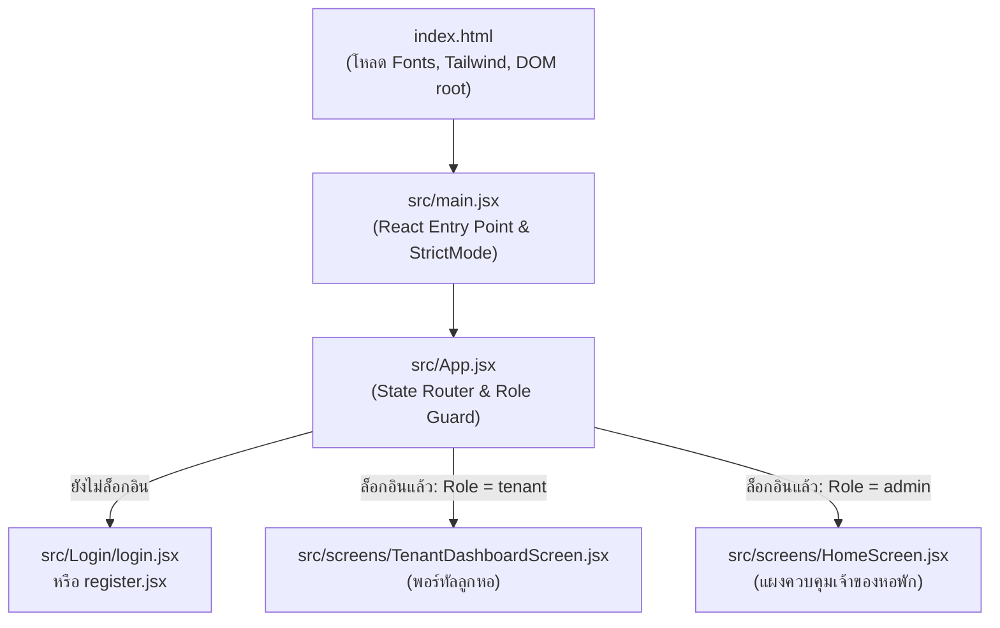

# เอกสารอธิบายการทำงานของระบบ (Code Architecture & Flow)

ระบบนี้เป็นเว็บแอปพลิเคชันจัดการหอพัก (**Dormitory Management System**) พัฒนาด้วย **React 19**, **Vite**, **Tailwind CSS** และ **Lucide React** โดยเชื่อมต่อกับ Backend API ผ่าน Fetch API

---

## 1. จุดเริ่มต้นการทำงาน (Application Entry Points)

การทำงานของระบบจะเริ่มต้นจากไฟล์ตามลำดับดังนี้:



### 1.1 `index.html` (จุดเริ่มต้นแรกสุดใน Browser)
- โหลดฟอนต์ภาษาไทย **Prompt** และ **Kanit** จาก Google Fonts
- โหลดและตั้งค่า **Tailwind CSS** ผ่าน CDN (กำหนดโทนสีหลัก `brand` เช่น `#f43f5e`, `#ff3377`)
- มีแท็ก `<div id="root"></div>` สำหรับให้ React นำ Component มา Render
- โหลดโมดูล React ตัวแรกผ่าน `<script type="module" src="/src/main.jsx"></script>`

### 1.2 `src/main.jsx` (จุดบูตสแตรป React)
- ใช้ `createRoot(document.getElementById('root'))`
- นำคอมโพเนนต์ `<App />` มาครอบด้วย `<StrictMode>` เพื่อเรนเดอร์ลงใน DOM

### 1.3 `src/App.jsx` (ตัวควบคุมสถานะและเส้นทางหลัก - Root Router)
ไฟล์นี้ทำหน้าที่เป็น **Authentication & Role-based Routing**:
- **ตรวจสอบการเข้าสู่ระบบ:** อ่านข้อมูลผู้ใช้จาก `localStorage.getItem('dorm_user')`
- **การคัดแยกหน้าจอ (Flow Decision):**
  1. **ยังไม่ได้ล็อกอิน (`!isAuthenticated`):**
     - แสดงคอมโพเนนต์ `<Login />`
     - หากผู้ใช้กดสลับหน้าลงทะเบียน จะแสดง `<Register />`
  2. **ล็อกอินแล้ว และเป็นลูกหอพัก (`currentUser?.role === 'tenant'`):**
     - แสดงหน้าจอ `<TenantDashboardScreen />` เท่านั้น (ป้องกันไม่ให้ลูกหอเข้าถึงข้อมูลจัดการของหอพัก)
  3. **ล็อกอินแล้ว และเป็นเจ้าของหอพัก (`admin`):**
     - แสดงหน้าจอ `<HomeScreen />` สำหรับบริหารจัดการหอพักเต็มรูปแบบ

---

## 2. โครงสร้างโฟลเดอร์และไฟล์สำคัญ

```
my-frontend2/
├── index.html                   # ไฟล์ HTML หลัก
├── package.json                 # กำหนด Dependencies (React 19, Lucide, Vite)
├── vite.config.js               # ตั้งค่า Vite และ React Plugin
└── src/
    ├── main.jsx                 # Entry point ของ React
    ├── App.jsx                  # Main Router เช็คสิทธิ์และควบคุมหน้าจอ
    ├── index.css / App.css      # สไตล์ CSS หลัก
    │
    ├── services/
    │   └── api.js               # รวมฟังก์ชัน Fetch ข้อมูลไปยัง Backend API
    │
    ├── Login/
    │   ├── login.jsx            # หน้าจอล็อกอิน (Username/Password หรือ PIN)
    │   ├── register.jsx         # หน้าจอลงทะเบียนลูกหอพัก (ผูกกับห้อง)
    │   └── login.css            # สไตล์เฉพาะของหน้าล็อกอิน
    │
    ├── screens/
    │   ├── HomeScreen.jsx       # หน้าหลักของเจ้าของหอพัก (Admin Dashboard)
    │   └── TenantDashboardScreen.jsx # หน้าหลักของลูกหอพัก (ดูบิล, โอนเงิน, ส่งสลิป)
    │
    └── components/              # คอมโพเนนต์ Modal Popup ต่างๆ
        ├── CalculatorModal.jsx  # ป๊อปอัปคำนวณค่าน้ำ-ค่าไฟและสร้างบิล
        ├── RoomModal.jsx        # ป๊อปอัปเพิ่ม/แก้ไขข้อมูลห้องพัก
        ├── InvoiceModal.jsx     # ป๊อปอัปพิมพ์และดูรายละเอียดใบแจ้งหนี้/ใบเสร็จ
        ├── EditInvoiceModal.jsx # ป๊อปอัปแก้ไขบิลที่สร้างไปแล้ว
        ├── SlipVerifyModal.jsx  # ป๊อปอัปตรวจสลิปโอนเงิน (อนุมัติ/ปฏิเสธ)
        ├── SettingsModal.jsx    # ป๊อปอัปตั้งค่าหอพัก (ค่าน้ำ, ค่าไฟ, PromptPay)
        └── TenantPortalModal.jsx# ป๊อปอัปจำลองดูมุมมองลูกหอรายห้อง
```

---

## 3. รายละเอียดการทำงานของแต่ละส่วน (Detailed Workflows)

### 3.1 การเชื่อมต่อกับฐานข้อมูล (`src/services/api.js`)
ทำหน้าที่เป็นชั้นสื่อสารกับ Backend (`http://localhost:3000/api`) ผ่าน Fetch API แบ่งหมวดหมู่การทำงานดังนี้:
- **Auth:** `login`, `adminLogin`, `changeAdminPin`
- **Rooms:** `getRooms`, `createRoom`, `updateRoom`, `deleteRoom`, `clearRoomHistory`
- **Invoices:** `getInvoices`, `getInvoice`, `createInvoice`, `updateInvoice`, `deleteInvoice`
- **Payment & Slips:** `uploadSlip`, `confirmPayment`, `verifySlip`, `getPendingSlips`
- **Settings & Stats:** `getSettings`, `updateSettings`, `getDashboardStats`, `generatePromptPay`

---

### 3.2 หน้าจอฝั่งลูกหอพัก (`TenantDashboardScreen.jsx`)
เมื่อลูกหอพักเข้าสู่ระบบ หน้าจอนี้จะทำงานตามลำดับ:
1. อ่านหมายเลขห้องพักจาก `currentUser.room_number`
2. เรียกฟังก์ชัน `api.getTenantHistory(roomNumber)` เพื่อดึงบิลล่าสุด ประวัติย้อนหลัง และข้อมูลบัญชีหอพัก
3. หากมีบิลค้างชำระ จะสร้าง QR Code PromptPay อัตโนมัติด้วย `api.generatePromptPay()` ตามยอดจริง
4. **ฟังก์ชันการชำระเงิน:**
   - ผู้ใช้สแกน QR หรือคัดลอกเลขบัญชี/พร้อมเพย์
   - อัปโหลดไฟล์สลิปหลักฐานโอนเงิน แปลงไฟล์เป็น Base64
   - กดส่งสลิปผ่าน `api.uploadSlip()` เพื่อส่งเข้าสู่ระบบรอเจ้าของหออนุมัติ
5. สามารถกดดูใบแจ้งหนี้แบบเต็มหรือดาวน์โหลดผ่าน `<InvoiceModal />`

---

### 3.3 หน้าจอฝั่งเจ้าของหอพัก (`HomeScreen.jsx`)
เมื่อ Admin เข้าสู่ระบบ จะมีการโหลดข้อมูลเริ่มต้นพร้อมกันผ่าน `Promise.all`:
- สถิติต่างๆ (`getDashboardStats`)
- ข้อมูลการตั้งค่าหอพัก (`getSettings`)
- รายการใบแจ้งหนี้ทั้งหมด (`getInvoices`)
- รายชื่อห้องพักและสถานะทั้งหมด (`getRooms`)
- รายการสลิปที่รอยืนยัน (`getPendingSlips`)

แถบการทำงานหลัก 4 แท็บ:
1. **Dashboard Tab:**
   - การ์ดสรุปจำนวนห้องว่าง, ห้องมีผู้เช่า, ห้องปรับปรุง
   - สรุปยอดเงินค้างชำระ และยอดเงินที่ชำระแล้ว
   - การ์ดแจ้งเตือนสลิปรอตรวจสอบด่วน
2. **Invoices Tab (จัดการใบแจ้งหนี้):**
   - ค้นหาบิลตามเลขห้อง หรือชื่อผู้เช่า
   - กรองตามเดือน (`YYYY-MM`) และสถานะ (ค้างชำระ / ชำระแล้ว)
   - ปุ่มเปิด `<CalculatorModal />` เพื่อออกบิลใหม่
   - ปุ่มดูใบเสร็จ (`<InvoiceModal />`), ปุ่มแก้ไขบิล (`<EditInvoiceModal />`), ปุ่มลบบิล
3. **Rooms Tab (จัดการห้องพัก):**
   - ดูห้องพักแยกตามชั้น (Floors)
   - แสดงสถานะห้องว่าง (สีเขียว), มีผู้เช่า (สีน้ำเงิน), แจ้งซ่อม (สีเหลือง)
   - เพิ่มห้องใหม่ หรือแก้ไขข้อมูลผู้เช่าและค่าเช่าผ่าน `<RoomModal />`
4. **Analytics Tab (สถิติและรายงาน):**
   - วิเคราะห์ภาพรวมรายได้ ค่าน้ำ ค่าไฟ และแนวโน้มรายรับ

---

### 3.4 โมดอลคำนวณบิล (`CalculatorModal.jsx`)
การออกบิลประจำเดือนทำงานดังนี้:
1. เลือกห้องพัก ระบบจะดึงค่าเช่าเดิม เลขมิเตอร์น้ำ/ไฟครั้งก่อนมาแสดงอัตโนมัติ
2. กรอกเลขมิเตอร์น้ำและไฟครั้งล่าสุด
3. ระบบคำนวณผลต่าง (หน่วยที่ใช้) x อัตราต่อหน่วย
4. รวมค่าส่วนกลาง ค่าธรรมเนียมอื่นๆ หรือส่วนลด
5. กดบันทึกเพื่อยิง API `api.createInvoice()` และอัปเดตเลขมิเตอร์ล่าสุดให้ห้องพักโดยอัตโนมัติ

---

### 3.5 โมดอลตรวจสอบสลิป (`SlipVerifyModal.jsx`)
เมื่อลูกหอโอนเงินและส่งสลิปเข้ามา:
1. เจ้าของหอจะเห็นแจ้งเตือนสลิปรอตรวจสอบ
2. คลิกดูภาพสลิปขนาดใหญ่ เปรียบเทียบกับยอดเงินที่ต้องชำระ
3. กด **"อนุมัติ (Approve)"** ระบบจะเปลี่ยนสถานะบิลเป็น `paid` (ชำระแล้ว)
4. หรือกด **"ปฏิเสธ (Reject)"** พร้อมระบุหมายเหตุ เพื่อให้ลูกหอส่งใหม่อีกครั้ง

---

## 4. สรุปภาพรวมวงจรข้อมูล (Data Flow Summary)

```
[ผู้ใช้กรอกข้อมูล / อัปโหลด] 
       │
       ▼
[React Components / Modals] 
       │ (State & Form Handling)
       ▼
[src/services/api.js] 
       │ (HTTP Fetch REST API)
       ▼
[Backend Server (localhost:3000)] 
       │
       ▼
[MySQL Database]
```
